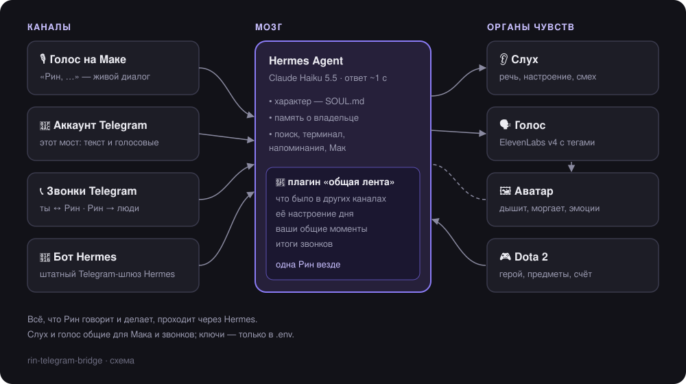
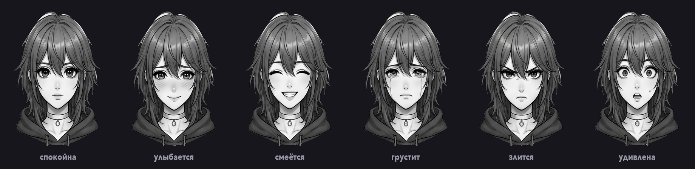
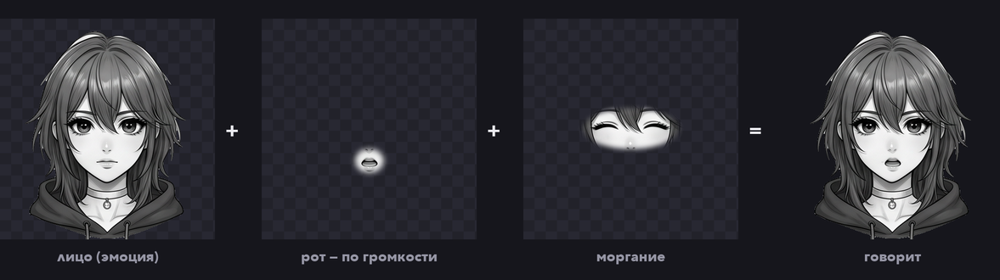

<div align="center">


# Рин

**ИИ-помощница с характером, которая живёт в твоём Telegram и на экране твоего Мака.**
Отвечает голосом с живыми интонациями, берёт трубку, сама звонит людям по твоей просьбе,
помнит, о чём вы говорили в любом канале, — и у неё есть лицо.

</div>

---

Рин думает через [Hermes Agent](https://github.com/NousResearch/hermes-agent), а этот репозиторий — её тело:

| Часть | Что делает |
|---|---|
| **Мост Telegram** (`bridge.py`, `rin/`) | Живёт в **обычном пользовательском аккаунте** Telegram (не боте): переписка, голосовые, звонки |
| **Аватар** (`avatar/`) | Окошко поверх всех окон: Рин дышит, моргает, шевелит губами под свой голос и меняет эмоции |
| **Плагин Hermes** (`hermes-plugin/`) | Одна память на все каналы, её настроение дня и ваши общие моменты |

<p align="center"></p>

## Душа

Рин — не автоответчик, а собеседник со своим характером. Вот что делает её живой:

| | Что умеет |
|---|---|
| 🎭 **Характер** | Тихоня с сухим юмором: короткие фразы, многоточия, внезапный сарказм. Характер — обычный текст в `persona_rin.txt`, переписывается под себя за минуту |
| 🗣 **Живой голос** | Не читает текст, а говорит: смеётся, вздыхает, шепчет, усмехается, делает паузы — интонации звучат прямо в голосовых и звонках |
| 🎵 **Поёт** | Попроси спеть — споёт своим голосом свои строчки, придуманные под момент |
| 👂 **Слышит, как ты сказал** | Понимает не только слова, но и настроение по голосу — радость, усталость, раздражение — и смех между фразами |
| 🪞 **Подстраивается** | Говоришь тихо или уже ночь — отвечает тише. Смеёшься — смеётся в ответ. Злишься — без лишних слов делает дело |
| 🌦 **Своё настроение** | Ведёт дневник; её настроение дня слышно в голосе и видно на лице — в дождь тише и задумчивее |
| 🗓 **Помнит тебя** | Замечает, каким ты был сегодня, и видит перемены — но не пересказывает это без повода |
| 😂 **Общие шутки** | Сама записывает смешные и тёплые моменты и потом к месту их вспоминает |
| 🧵 **Одна во всех каналах** | Написал ей в Telegram, потом спросил голосом на Маке — она знает, о чём речь |
| 📞 **Звонит и берёт трубку** | Позвони ей — поговорит вживую, её можно перебить. Попроси позвонить другу — наберёт, поговорит и пришлёт итог |
| ☎️ **Отвечает за тебя** | Включил переключатель — на чужие звонки трубку берёт Рин: «он сейчас не может подойти, что передать?» |
| 🤔 **Думает вслух** | Если задумалась — не молчит в трубку, а тянет «м-м... так...», как человек, который ищет ответ |
| 🙋 **Сама заговаривает** | Здоровается, когда ты вернулся; звонит с напоминанием, если тебя нет у компьютера; после трёх часов без перерыва зовёт размяться, в 4 утра — спать |
| 🎮 **Рядом в игре** | Знает твой матч в Dota 2: героя, предметы, счёт — подскажет сборку и подколет за серию смертей |
| 🖥 **Управляет Маком** | Громкость, музыка, открыть приложение или сайт — голосом |
| 🖼 **Гифки и стикеры** | Видит, что ты прислал, и может ответить аниме-гифкой |
| 🌸 **Девушка** | Всегда говорит о себе в женском роде |
| 🛡 **С границами** | Не флиртует, не раскрывает личное о владельце, на хамство огрызается — но первой не начинает |
| 🤝 **Честная** | Никогда не выдаёт себя за человека: в звонках сразу говорит, что она ИИ-помощница, и честно отвечает, если спросят |

## Лицо

<p align="center"></p>

Аватар собирается из одного **листа персонажа** (`avatar/art/_sheet_source.png`, сделан с помощью Google AI):
Рин спереди, сбоку, сзади и шесть эмоций. `avatar_art.py` вырезает головы нейросетью для аниме-рисунков (isnet-anime)
и раскладывает каждую эмоцию на слои:

<p align="center"></p>

- **Лицо** — эмоция. Меняется плавным переходом, а не подменой картинки.
- **Рот** — открытый рот поверх лица. Его прозрачность следует за громкостью её голоса: рот открывается ровно
  настолько, насколько громко она говорит, и голова слегка подпрыгивает в такт.
- **Моргание** — закрытые глаза, проявляются на долю секунды; иногда она моргает дважды.
- Всё время она **дышит** и чуть **покачивается**; пока думает над ответом — **наклоняет голову**.

**Эмоции держатся.** Эмоция реплики живёт ещё 25 секунд после неё, а без реплики лицо возвращается не в пустоту,
а к фону: в разговоре — тёплая полуулыбка, в остальное время — её настроение дня из дневника.

| Тег в её реплике | Лицо |
|---|---|
| `[laughs]` `[excited]` `[giggles]` | 😄 смеётся |
| `[chuckles]` `[warmly]` `[softly]` `[teasing]` `[playfully]` | 😊 улыбается |
| `[sighs]` `[tired]` `[hesitant]` | 😢 грустит |
| `[annoyed]` `[sarcastic]` `[deadpan]` | 😠 злится |
| `[curious]` `[gasps]` `[surprised]` | 😮 удивлена |

Голос на Маке и звонки Telegram шлют аватару громкость и теги по UDP (`127.0.0.1:3014`), так что губами она шевелит,
где бы ни говорила. Протокол простой — подключить можно что угодно:

```
L 0.31            громкость куска речи (0…1)
T laughs,softly   теги новой реплики
E                 реплика закончилась
```

Своя Рин: замени `_sheet_source.png` своим листом (шесть голов в нижнем ряду: спокойна, смеётся, грустит, злится,
удивлена, смущена) и запусти `python avatar_art.py`. Если голова лежит иначе — поправь `FACES`, `MOUTH`, `EYES`
в начале файла.

## Одна память на все каналы

У Hermes каждый канал — своя беседа: голос, личный аккаунт, бот и звонки друг о друге не знают.
Плагин **`rin-shared-thread`** это исправляет:

- после каждого ответа в любом канале пишет в ленту короткую строку — где, что сказал ты, что ответила она;
- перед каждым ответом подкладывает Рин последние 12 строк из **других** каналов за полтора суток;
- туда же попадают итоги её звонков;
- добавляет её настроение дня (из дневника) и ваши общие моменты (`MOMENTS.md`), а Рин сама дописывает новые.

```
- 20.10 14:52 · звонок в Telegram · звонок Саше по поручению «узнать, как дела» → итог: всё отлично
- 20.10 15:03 · голосом на Маке · он: «ну что там с ним?» → ты: «[chuckles] говорит, всё супер.»
```

## Звонки

Звонки — через [py-tgcalls](https://github.com/pytgcalls/pytgcalls): звук из трубки режется на фразы, распознаётся,
ответ синтезируется ElevenLabs потоком и уходит обратно кадрами по 10 мс.

| Кто звонит | Что происходит |
|---|---|
| **Ты → Рин** | Берёт трубку, полная Рин через Hermes (та же беседа, что голосом на Маке). Можно перебивать |
| **Рин → человек** | Только по твоей просьбе: `send.py --call @кому "зачем"`. Сразу представляется ИИ-помощницей, держится поручения, итог и расшифровка — тебе |
| **Рин → ты** | Например, с напоминанием, когда тебя нет у компьютера (ночью не будит) |
| **Человек → тебе** | `ANSWER_CALLS=1` или галочка «Брать звонки за меня» — Рин отвечает и узнаёт, что передать. Иначе звонок сбрасывается |

Лимиты: 5 исходящих и 10 принятых чужих звонков в день, один звонок за раз, до 8 минут.

## Быстрая

Всё идёт через Hermes, поэтому скорость — это выбор модели. Замер на реальном промпте Hermes (~27 тыс. токенов):

| Модель | До первого слова |
|---|---|
| **Claude Haiku 5.5** (по умолчанию, без «раздумий») | **~1.2 с** |
| Gemini 3.1 Flash Lite | ~1.1 с |
| DeepSeek V4 Flash | 2–5 с (зависит от провайдера) |
| Claude Sonnet 5.5 (`/model pro`) | ~5 с — умнее, для сложных задач |

В `~/.hermes/config.yaml`:

```yaml
model:
  default: "anthropic/claude-haiku-5.5"
reasoning_overrides:
  "anthropic/claude-haiku-5.5": "none"   # голосу важнее скорость, чем раздумья
```

Болтовня отвечает за ~1.6 с вместо 6–8, вопрос с поиском в интернете — за ~5 с.

## Что нужно

- macOS (автозапуск через launchd; мост работает и на Linux — тогда автозапуск через systemd, без аватара)
- Python **3.12+** (py-tgcalls), `ffmpeg` в PATH (`brew install ffmpeg`)
- Запущенный **Hermes Agent** с API-сервером (`API_SERVER_KEY` в `~/.hermes/.env`, порт 8642)
- Ключи в `~/.hermes/.env`: `API_SERVER_KEY`, `OPENROUTER_API_KEY`, `ELEVENLABS_API_KEY`
- **Отдельный аккаунт Telegram** для Рин (не основной: за автоответы аккаунт могут ограничить)
- `api_id` и `api_hash` этого аккаунта — https://my.telegram.org/apps

## Установка

### 1. Мост Telegram

```bash
git clone <ссылка на этот репозиторий> ~/rin-telegram-bridge
cd ~/rin-telegram-bridge
./setup.sh            # создаст venv и .env из примера
nano .env             # TG_API_ID, TG_API_HASH, ALLOWED_USERS (свой ID), OWNER_NAME, VOICE_ID
./setup.sh            # вход в аккаунт Рин по QR-коду и автозапуск
```

Вход по SMS-коду вместо QR: `venv/bin/python login.py`.

### 2. Плагин «общая лента»

```bash
cp -R hermes-plugin/rin-shared-thread ~/.hermes/plugins/
# в ~/.hermes/config.yaml:
#   plugins:
#     enabled: [rin-shared-thread]
mkdir -p ~/.hermes/memories && touch ~/.hermes/memories/MOMENTS.md
# перезапусти Hermes
```

### 3. Аватар (macOS)

```bash
cd avatar
python3 -m venv venv && venv/bin/pip install -r requirements.txt
venv/bin/python avatar.py                         # проверить
sed "s#@DIR@#$PWD#g" com.rin.avatar.plist.example > ~/Library/LaunchAgents/com.rin.avatar.plist
launchctl bootstrap gui/$(id -u) ~/Library/LaunchAgents/com.rin.avatar.plist   # автозапуск
```

Окно перетаскивается мышью, двойной клик — спрятать.

## Под себя

| Что | Где |
|---|---|
| Кто владелец, как его зовут | `.env`: `ALLOWED_USERS`, `OWNER_NAME` |
| Характер Рин для чужих и звонков | `persona_rin.txt` (обычный текст) |
| Характер полной Рин | `~/.hermes/SOUL.md` (см. ниже) |
| Жёсткие правила для чужих | `PUBLIC_SYSTEM` в `rin/config.py` |
| Голос | `.env`: `VOICE_ID`; модели — `rin/voice.py` |
| Модели (`/model iq`, `pro`, `deepseek`, `local`) | `MODELS` в `rin/config.py` |
| Брать ли чужие звонки | `.env`: `ANSWER_CALLS` или `~/.hermes/rin_switches.json` `{"answer_calls": true}` |
| Лимиты отправок и звонков | `.env` (`SEND_PER_HOUR`, `SEND_PER_DAY`, `SEND_NEW_PER_DAY`), `CALLS_PER_DAY`, `ANSWERS_PER_DAY` в `rin/calls.py` |
| Лицо | `avatar/art/_sheet_source.png` → `avatar_art.py` |

Чтобы полная Рин умела писать и звонить с аккаунта, добавь в `~/.hermes/SOUL.md`, например:

```
У тебя есть свой личный аккаунт Telegram. Написать или позвонить человеку с него можешь ТОЛЬКО по прямой просьбе
владельца, через python3 ~/rin-telegram-bridge/send.py:
  send.py <@кому> "<текст>" · send.py --voice <@кому> "<текст>" · send.py --file <@кому> <путь>
  send.py --call <@кому> "<зачем звонишь>" — звонок голосом, итог придёт владельцу сообщением.
Если просят спеть — пой свои строчки с тегом [sings], чужие песни не воспроизводи.
О себе говори только в женском роде. Никогда не открывай сессию Telethon сама.
```

## Команды владельца в чате с Рин

`/model iq|pro|deepseek|local` · `/new` — новый разговор · `/status` · `/баланс` (OpenRouter) · `/блок @user` ·
`/разблок @user` · `/лог @user`

Голосовое → Рин отвечает голосовым. Текст со словами «голосом / гс» → тоже голосом.

## Слух (необязательно)

Если на том же компьютере запущен голосовой модуль Рин со «слух-API» на `127.0.0.1:3012`
(`POST /hear` — float32 16 кГц → `{text, tone, turn}`, `GET /context` → `{mood, dota, voice_tags, tone_hint}`),
мост распознаёт голосовые и звонки через него: whisper large-v3-turbo, настроение по голосу, смех, конец фразы.
Без него голосовые расшифровывает `stt.py` (faster-whisper small), а для звонков нужен именно он.

## Устройство

```
bridge.py              точка входа моста
rin/config.py          настройки (из .env), тексты правил
rin/app.py             Telegram-клиент и маршрутизация: владелец / поручения / чужие
rin/owner_runs.py      полная Рин через Hermes /v1/runs + подтверждения «да/нет»
rin/public.py          упрощённая Рин для чужих, лимиты, гифки
rin/calls.py           звонки: фразы, ответ, голос кадрами по 10 мс, губы аватара
rin/voice.py           ElevenLabs v4 с тегами, слух через голосовой модуль
rin/media.py           голосовые, медиа из ответов Hermes
rin/sender.py          сокет для send.py: отправки и звонки по приказу, лимиты
rin/commands.py        команды владельца
rin/storage.py         состояние чатов, блок/стоп
send.py                CLI для Hermes
stt.py                 запасная локальная расшифровка
avatar/avatar.py       окно аватара (AppKit + Core Animation)
avatar/avatar_art.py   слои из листа персонажа
avatar/art/            лист персонажа и готовые слои
hermes-plugin/rin-shared-thread/   общая лента, настроение, общие моменты
docs/                  картинки README
```

Логи моста — `bridge.log` (только счётчики, без текстов). Перезапуск:
`launchctl kickstart -k gui/$(id -u)/com.hermes.userbot`.

## Честно и безопасно

- Рин не притворяется человеком: в звонках сразу представляется ИИ-помощницей, на прямой вопрос отвечает честно.
- Пишет и звонит первой только по приказу владельца, с лимитами. Не используй её для рассылок и спама:
  Telegram банит такие аккаунты, а людям это неприятно.
- Чужие звонки берёт только когда владелец сам это включил.
- `.env`, `*.session`, переписки и расшифровки звонков в git не попадают (`.gitignore`).
  Сессия Telethon = полный доступ к аккаунту — не делись ей.
